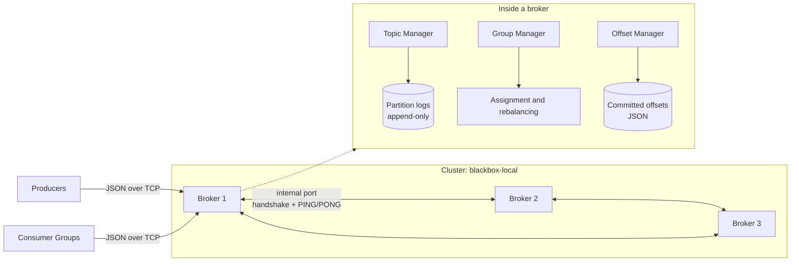

  

Computer Science Engineer · Software Developer · Master's student at the University of Siegen

  
  
  

I'm a backend engineer who likes understanding systems from the inside out. I build things from first principles (logs, sockets, protocols, coordination) so I know *why* production systems behave the way they do, not just how to use them.

---

## ⚡ Currently

- 🔨 Building **[BLACKBOX](https://github.com/swamil-5504/BLACKBOX)**, a Kafka-inspired message broker in plain Java
- 🎓 Pursuing my M.Sc. in Computer Science (*Complex and Intelligent Software Systems*) at the **University of Siegen**
- 📚 Going deeper into distributed systems, storage engines and computer vision

---

## 🚀 Projects

### [BLACKBOX](https://github.com/swamil-5504/BLACKBOX): Kafka-inspired distributed messaging broker

`Java` · `Java NIO` · `TCP` · `Jackson` · `Gradle`

A message broker built from scratch with no messaging framework, to understand how systems like Kafka work internally.

- **Storage:** append-only binary partition logs on `FileChannel`, sequential per-partition offsets, and automatic recovery of topics and offsets on restart.
- **Messaging:** topics with configurable partitions, a thread-safe round-robin producer, and offset-based consumers.
- **Consumer groups:** membership, topic subscriptions, round-robin partition assignment and **automatic rebalancing** when consumers join or leave.
- **Safety:** assignment-aware fetching (a consumer can only read partitions it owns) and validated, persistent per-group committed offsets for at-least-once consumption.
- **Protocol:** newline-delimited JSON over TCP with 10 commands and a thread per client connection.
- **Multi-broker networking:** shared cluster config, separate client and internal ports, a validated handshake (broker ID and cluster name), startup retries, and persistent inter-broker connections with PING/PONG.

Replication, metadata sync, leader election and failover are the next steps.

### PropertiesAnywhere: full-stack Android app for property rental

`Flutter` · `Dart` · `Java` · `Spring Boot` · `PostgreSQL`

A property-rental app with user authentication, property listings, city-based search and listing management. It includes a messaging system between users with read/unread status and unread-message counters, and connects the mobile app to REST APIs and a PostgreSQL-backed Spring Boot service.

### Altrium: blockchain-based degree verification

`React` · `TypeScript` · `FastAPI` · `MongoDB` · `Solidity` · `Docker`

A platform where universities issue tamper-proof **Soulbound Tokens** on Ethereum Sepolia and employers verify degree credentials instantly. It includes role-based access control, validation of university accreditation, Telegram notifications and Docker-based deployment.

---

## 💼 Experience

| Role | Company | When | Stack | Highlights |
|---|---|---|---|---|
| Product Engineer Intern | **Allstate India** | Feb – Jul 2026 | Java, Spring Boot, React | Backend services and REST APIs for the Vendor Assignment Tool (VAT) |
| Software Engineering Intern | **ThriveStack.ai** | Sep – Dec 2025 | Go, gRPC, GraphQL, Next.js, ClickHouse | **42%** ClickHouse query performance improvement |
| Backend Engineer Intern | **GoQuant** | Jun – Sep 2025 | FastAPI, OEMS backend, FIX protocol | OTC desk integrations, **28%** order throughput increase |

---

## 📄 Publications

- *Automated Psychological Profiling from Children's Drawings Using Deep Learning and NLP*, IEEE ICoICC 2025
- *IoT and AI-Driven Dynamic Traffic Signal Manipulation using V2I Communication*, IEEE ICICCS 2025
- *Leveraging Computer Vision to create an Intelligent Threat Detection System for Visually Impaired*, IEEE IITCEE 2025

---

## 🧰 Tech

  

**Where I'm strongest:** backend services (Java/Spring Boot, Go, Python/FastAPI), data-heavy query paths (ClickHouse, GraphQL, gRPC), low-level systems work (storage, sockets, protocols), and financial-systems integration (FIX).

---

## 📫 Contact

  
  
  

