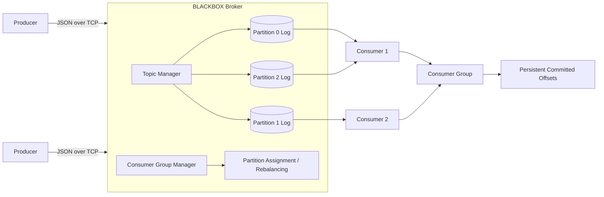

  

Computer Science Engineer · Software Developer · Master's student at the University of Siegen

  
  
  
  

---

## ⚡ Currently
- 🔨 Building **BLACKBOX**, a message broker from scratch in Java
- 🎓 Pursuing my Master's at the **University of Siegen**
- 📚 Digging deeper into distributed systems, storage engines and computer vision

---

## 🚀 Featured project

  

**[BLACKBOX](https://github.com/swamil-5504/BLACKBOX)** is a Kafka-inspired message broker built from scratch in Java: persistent partition logs, topics, producers, consumer groups with committed offsets, and a JSON-over-TCP protocol.

---

## 💼 Experience

| Role | Company | When | Stack | Highlights |
|---|---|---|---|---|
| Product Engineer Intern | **Allstate India** | Feb – Jul 2026 | Java, Spring Boot, React | Full-stack product engineering |
| Software Engineering Intern | **ThriveStack.ai** | Sep – Dec 2025 | Go, gRPC, GraphQL, ClickHouse | **42%** query performance improvement |
| Backend Engineer Intern | **GoQuant** | Jun – Sep 2025 | FastAPI, OEMS backend, FIX protocol | Trading-system backend work |

---

## 🧰 Tech

  

  
  

---

## 📊 GitHub stats

  
  

  

  

---

## 📫 Contact

  
  
  

